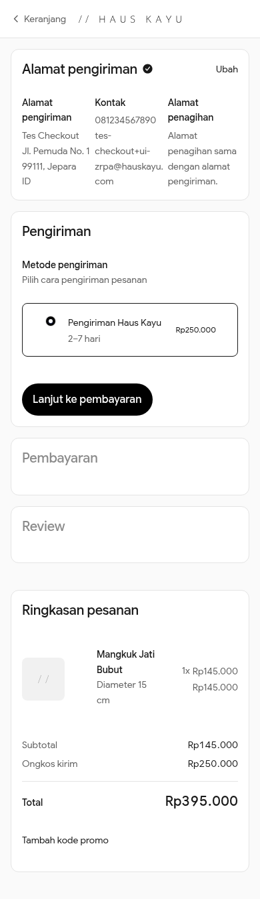
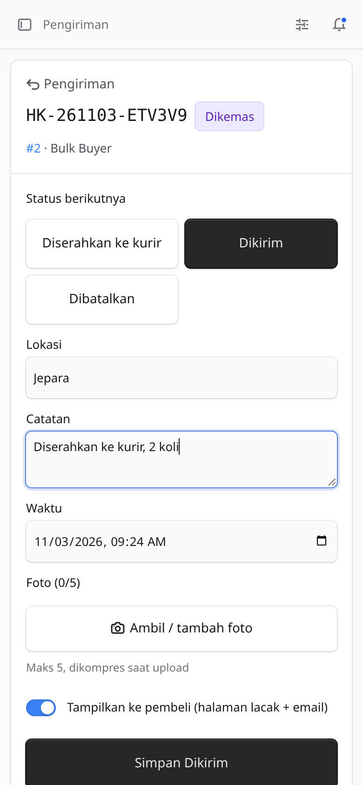
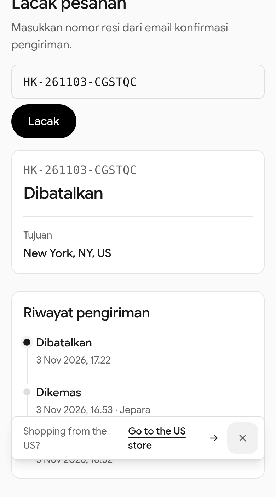
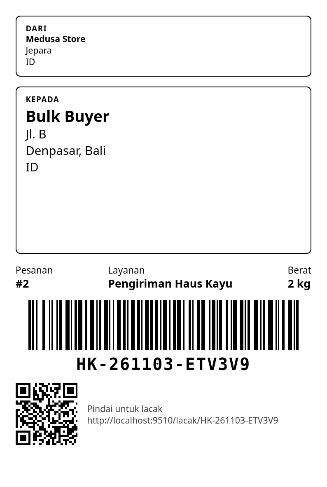
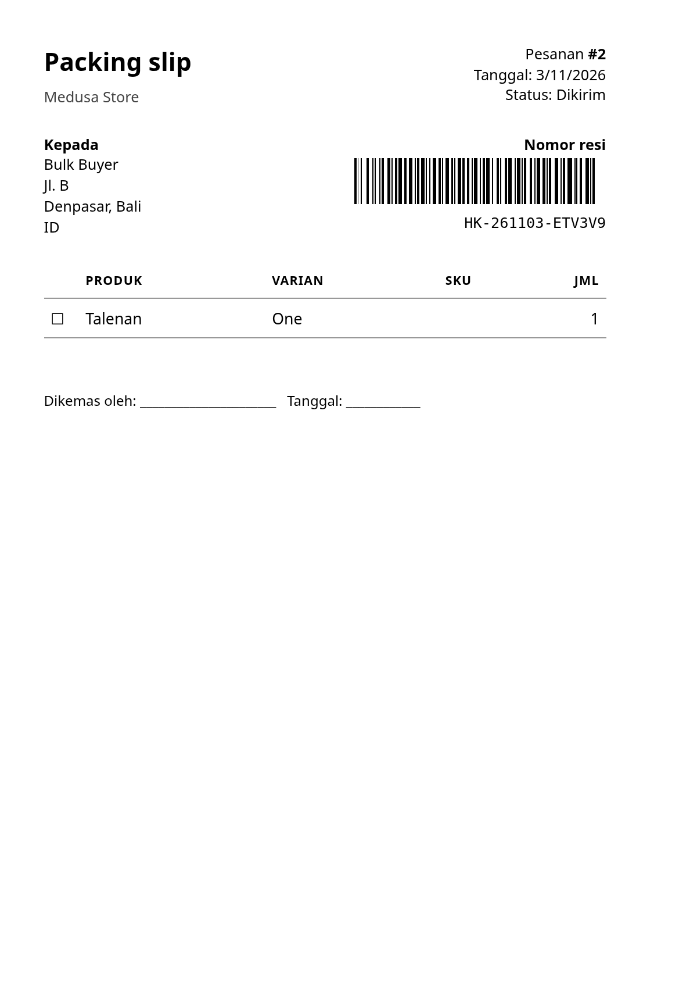
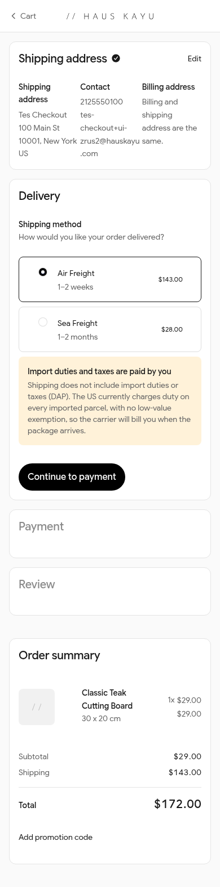

# Zone Rate & Tracking — by Haus Kayu

Calculated shipping for Medusa v2 (price per kilogram by destination zone, on the chargeable weight: the larger of
actual and volumetric weight) and shipment tracking (own tracking numbers, status timeline, live tracking page,
mobile-first Admin, A6 labels).

> Ongkir terhitung untuk Medusa v2: tarif per kg menurut zona tujuan, dari berat tagih (yang lebih besar antara berat
> aktual dan berat volume). Dibuat dan dipakai sendiri oleh Haus Kayu.

**Status:** 0.1.0 in development, not published yet; tested on Medusa 2.19 and 2.22, running on hauskayu.com.

| Checkout | Admin (phone) | Tracking page |
| --- | --- | --- |
|  |  |  |

| A6 label | Packing slip | International checkout |
| --- | --- | --- |
|  |  |  |

[English](#english) · [Bahasa Indonesia](#bahasa-indonesia)

---

## English

### What it does

- **Fulfillment provider with calculated prices** (`zone-rate_zone-rate`): the price comes from the cart and the
  shipping address, never a flat amount.
- **One config file** holds every service, zone, rate, divisor and estimate. Each service (e.g. domestic, air, sea)
  is one fulfillment option, so one shipping option in Medusa.
- **Chargeable weight**, the same for every service:

  ```
  actual      = Σ (variant weight × qty)                    grams, from variant.weight
  volumetric  = Σ (L × W × H / divisor × qty)               cm, from variant.length/width/height
  chargeable  = max(actual, volumetric) in kg, rounded UP to a whole kg, at least 1 kg
                1.1 kg → 2 kg · 0.3 kg → 1 kg · 2.0 kg → 2 kg
  price       = chargeable × rate per kg of the zone
  ```

  Integer arithmetic only (milligrams, 0.01 mm steps, whole currency units), so floats never push a parcel into the
  next kilogram. The divisor defaults to 6000 and can be set per service. Units default to grams and centimetres.
- **Product fallback**: a variant without weight or dimensions uses its product's values (option, on by default).
- **Never 0**: shipping is **refused** with a clear message (English/Indonesian) when the destination is unknown or a
  line has no weight or misses a dimension. Checkout shows the message and the option cannot be added.
- **Rejection log** in the Admin (time, cart, reason, the province as typed, the variants at fault), with repeats for
  the same cart counted on one row.
- **Incomplete variants report** in the Admin: every variant without weight or a dimension, with a link to edit it
  and a CSV export.
- **Tolerant province matching** for Indonesia: the 38 provinces by ISO 3166-2 code (`ID-JT`, `JT`), official and
  English names, common abbreviations (Jabar, Jateng, DIY, NTB, Kaltim, Sulsel, Kepri, Babel …), old and new
  spellings (Sumatra/Sumatera, Jogja), with or without "Provinsi"/"Prov.", any case and spacing.
- **Fixed exchange rate** for carts in another currency: rates stay in your base currency, the price is converted
  and rounded **up** to a whole unit. The rate and the date you set it are shown in the Admin.
- Admin pages in English and Indonesian; a small "by Haus Kayu" credit you can turn off.


### Tracking

- **Shipment per order**, created when the payment is captured (option `tracking.autoCreate`: `"payment.captured"`,
  `"order.placed"` or `false`), or from the order page in the Admin. Automatic creation happens once per order:
  never for canceled, archived or draft orders, never again after a shipment existed (also a canceled one), so
  replayed events are harmless; an admin can re-issue one after a cancellation.
- **Tracking numbers** like `HK-261103-7K3QX9`: prefix, ship date (store time zone), five random symbols and a check
  symbol that catches every single-symbol typo; unique in the database. A third-party carrier's name, number and
  link can be added alongside.
- **Statuses** `diproses` → `dikemas` → `diserahkan_ke_kurir` / `dikirim` → `transit` → `tiba_di_kota_tujuan` →
  `dalam_pengantaran` → `terkirim`, plus `gagal_kirim`, `dikembalikan`, `dibatalkan` (labels in English and
  Indonesian). Add or relabel statuses with `tracking.statuses`; other transitions are refused.
- **Medusa in step**: a shipped status creates the Medusa fulfillment and shipment (label = our tracking number),
  `terkirim` marks it delivered, `dibatalkan` cancels an unshipped fulfillment.
- **Payment before shipping** (optional, off by default): with `tracking.requirePaidBeforeShipping: true` the shipped
  statuses (`diserahkan_ke_kurir`, `dikirim`, or your own with `medusa: "shipped"`) are refused while the order still
  has an outstanding amount (total minus captured payments), for stores that bill in parts (deposit + balance).
  Other statuses are not affected. Authorized-but-not-captured payments count as outstanding.
- **Timeline** (append-only): status, note, location, time, admin, shown-to-buyer, up to 5 proof photos per update
  (compressed on the server to WebP, longest side 1600 px, EXIF/GPS removed; stored in the database, not public).
- **Live**: open tracking pages and Admin pages update over Server-Sent Events (Redis pub/sub across processes when
  Redis is configured), with 30-second polling as fallback.
- **Events** `shipment.created` and `shipment.status_updated` for your own subscribers (WhatsApp, Slack …).
- **E-mails** to the buyer for every status shown to them, through the Notification Module (English/Indonesian
  templates you can replace, one e-mail per event); skipped quietly without a provider.
- **Admin** (sidebar → Shipments): counts per status, late and shipped today; search by tracking number, order
  number, name or e-mail; filters; bulk update; one screen per shipment with big status buttons and camera upload;
  A6 label (Code 128 + QR to the tracking page) and packing slip; widget on the order page.
- **Storefront**: public lookup (status, city and times only, rate limited per IP) and the customer's own order
  timeline with notes and photos. See [examples/dtc-starter](examples/dtc-starter/README.md).

Plugin options (`plugins: [{ resolve: "medusa-fulfillment-zone-rate", options }]`):

```ts
{
  showCredit: true,
  // brand: { logoUrl: "https://shop.example/brand/logo.png" }, // printed on the A6 label + packing slip; default: store name as text
  tracking: {
    prefix: "HK",
    timeZone: "Asia/Jakarta",
    autoCreate: "payment.captured",
    // requirePaidBeforeShipping: true,                     // refuse "shipped" statuses while money is outstanding
    lookupsPerIpPerMinute: 30,
    trustedProxySecret: process.env.ZONE_RATE_PROXY_SECRET, // same value in the storefront
    label: { senderName: "My Store" },                      // default: store name + stock location address
    notifications: {
      storeName: "My Store",
      trackingUrl: { id: "https://shop.example/lacak/{tracking_number}", en: "https://shop.example/us/track/{tracking_number}" },
      // templates: { id: { subject, text, html? }, en: { … } }
    },
    // statuses: [{ id: "ditahan_bea_cukai", label: { en: "Held at customs", id: "Ditahan bea cukai" }, next: ["transit"] }],
  },
}
```

### Install

```bash
npm install medusa-fulfillment-zone-rate
npx medusa db:migrate
```

`medusa-config.ts`:

```ts
import shipping from "./shipping.config"

module.exports = defineConfig({
  // …
  plugins: [{ resolve: "medusa-fulfillment-zone-rate", options: { showCredit: true } }],
  modules: [
    {
      resolve: "@medusajs/medusa/fulfillment",
      options: {
        providers: [
          // keep Medusa's manual provider if you still use it
          { resolve: "@medusajs/medusa/fulfillment-manual", id: "manual" },
          { resolve: "medusa-fulfillment-zone-rate/providers/zone-rate", id: "zone-rate", options: shipping },
        ],
      },
    },
  ],
})
```

Then, in the Admin (Settings → Locations & Shipping):

1. Add the provider **zone-rate** to your stock location.
2. Create one shipping option per service with **price type "Calculated"** and pick the service (e.g. "domestic")
   as the fulfillment option. The option's `data.id` is the service id.

### Config

A complete example, Haus Kayu's own: [`examples/shipping.config.haus-kayu.ts`](examples/shipping.config.haus-kayu.ts).

```ts
import type { ZoneRateConfig } from "medusa-fulfillment-zone-rate/types"

const config: ZoneRateConfig = {
  currency: "idr",                                   // currency of every rate below
  exchange_rates: { usd: { rate: 16500, updated_at: "2026-11-03" } },  // IDR per 1 USD
  units: { weight: "g", dimension: "cm" },           // g | kg | lb | oz, mm | cm | m | in
  volumetric_divisor: 6000,
  product_fallback: true,
  locale: "auto",                                    // "auto" | "en" | "id" for the refusal messages
  services: [
    {
      id: "domestic",
      name: { en: "Standard shipping", id: "Pengiriman reguler" },
      destination: "province",                       // zone by province (one country)…
      country: "id",
      estimate: { min: 2, max: 7, unit: "day" },
      zones: [
        { id: "jawa", name: "Java", rate_per_kg: 30000, provinces: ["ID-JK", "Jawa Barat", "Jateng"] },
        // …
      ],
    },
    {
      id: "air",
      name: "Air Freight",
      destination: "country",                        // …or by country
      estimate: { min: 1, max: 2, unit: "week" },
      minimum_kg: 1,                                 // optional
      minimum_charge: 500000,                        // optional, in `currency`
      notice: { en: "Duties are paid by the buyer on delivery." },
      zones: [{ id: "us", name: "United States", rate_per_kg: 1285000, countries: ["us"] }],
    },
  ],
}
export default config
```

The config is checked when Medusa starts: a rate of 0 or with decimals, an unknown province, a province in two zones
or a duplicate id stops the server with a clear error instead of quoting a wrong price.

**Adding a zone**: add an entry to the service's `zones` with a new `id`, a `rate_per_kg` and its provinces or
countries, then restart Medusa. A destination may belong to only one zone per service.

**Another country by province**: `destination: "province"` matches Indonesian provinces today. For other countries
use `destination: "country"`, or open an issue to add a province list.

**Per-line package** (e.g. a custom item on a draft order, which has no variant): set
`line_item.metadata.zone_rate_package = { weight, length, width, height }` (per unit, in the config's units). Values
given there win over the variant's; missing or invalid ones fall through to the variant/product. The tracking
snapshot (zone, chargeable kg) reads the same values.

### Refusals

| Reason | When |
| --- | --- |
| `unknown_province` | the province is empty or not recognised, or no zone lists it |
| `unsupported_country` | the address is outside the service's country/countries |
| `incomplete_items` | a line has no weight or misses length, width or height (0 counts as missing) |
| `no_exchange_rate` | the cart's currency is not the base currency and has no rate |
| `no_address`, `no_items`, `unknown_service` | as named |

Medusa answers `POST /store/shipping-options/:id/calculate` and `POST /store/carts/:id/shipping-methods` with an
error carrying the message, in the cart's locale (`id…` → Indonesian, `en…` → English), else Indonesian for
Indonesian addresses and English otherwise.

### Admin

Sidebar → **Shipping rates**: rates and zones as configured, the exchange rate and its date, the incomplete variants
report (CSV export) and the rejection log.

Admin API (logged-in admin): `GET /admin/zone-rate/config`, `GET /admin/zone-rate/incomplete-variants`
(`?format=csv`), `GET /admin/zone-rate/rejections` (`?reason=&service_id=&limit=&offset=`).

### Development

See [CONTRIBUTING.md](CONTRIBUTING.md). `npm test` runs the unit tests; `node integration-tests/e2e.mjs` runs the
provider in a real Medusa app against a throwaway Postgres.

---

## Bahasa Indonesia

### Fitur

- **Provider fulfillment dengan harga terhitung** (`zone-rate_zone-rate`): ongkir dihitung dari keranjang dan alamat
  tujuan, bukan harga flat.
- **Satu file config** berisi semua layanan, zona, tarif, pembagi volume, dan estimasi. Tiap layanan (mis. domestik,
  udara, laut) jadi satu shipping option di Medusa.
- **Berat tagih** (sama untuk semua layanan): `max(berat aktual, berat volume)` dalam kg, **dibulatkan ke atas** ke kg
  penuh, minimal 1 kg (1,1 kg → 2 kg; 0,3 kg → 1 kg; 2,0 kg → 2 kg). Ongkir = berat tagih × tarif per kg zona.
  Hitungan pakai bilangan bulat, jadi tidak ada salah bulat karena float.
- **Fallback ke produk**: varian tanpa berat/ukuran memakai nilai produknya (bisa dimatikan).
- **Tidak pernah Rp0**: ongkir **ditolak** dengan pesan jelas (Indonesia/Inggris) kalau provinsi/negara tidak dikenal
  atau ada barang tanpa berat atau salah satu ukuran.
- **Log penolakan** dan **laporan varian belum lengkap** (link ke produk + export CSV) di Admin.
- **Pencocokan provinsi toleran**: 38 provinsi, kode ISO (`ID-JT`, `JT`), nama resmi dan Inggris, singkatan (Jabar,
  Jateng, DIY, NTB, Kaltim, Sulsel, Kepri, Babel, …), ejaan lama/baru (Sumatra/Sumatera, Jogja), dengan atau tanpa
  "Provinsi"/"Prov.", huruf besar/kecil dan spasi bebas.
- **Kurs tetap** untuk keranjang mata uang lain: tarif tetap dalam mata uang dasar, hasilnya dikonversi dan
  dibulatkan **ke atas** ke satuan penuh. Kurs dan tanggal update tampil di Admin.
- **Lunas sebelum dikirim** (opsional, default mati): `tracking.requirePaidBeforeShipping: true` menolak status kirim
  (`diserahkan_ke_kurir`, `dikirim`) selama order masih punya sisa tagihan, untuk toko yang menagih bertahap (DP +
  pelunasan).
- Admin dua bahasa (en/id) dan credit kecil "by Haus Kayu" yang bisa dimatikan (`showCredit: false`).

### Pasang

Lihat bagian [Install](#install) dan [Config](#config) di atas; contoh lengkap ada di
[`examples/shipping.config.haus-kayu.ts`](examples/shipping.config.haus-kayu.ts). Setelah itu, di Admin: tambahkan
provider **zone-rate** ke lokasi stok, lalu buat satu shipping option per layanan dengan tipe harga **Calculated**.

**Menambah zona**: tambahkan entri di `zones` dengan `id` baru, `rate_per_kg`, dan daftar provinsi/negaranya, lalu
restart Medusa. Satu tujuan hanya boleh ada di satu zona per layanan; config dicek saat start.

---

## About Haus Kayu

Teak furniture and crafts, made to order in Jepara, Indonesia — [hauskayu.com](https://hauskayu.com).

Other plugins by Haus Kayu: [medusa-payment-doit](https://github.com/haustex/pg-medusa-doit) (QRIS and virtual
accounts through doit.id) and [medusa-payment-manual-transfer](https://github.com/haustex/pg-medusa-manual-transfer)
(bank transfer with proof upload).

## License

[MIT](LICENSE)
